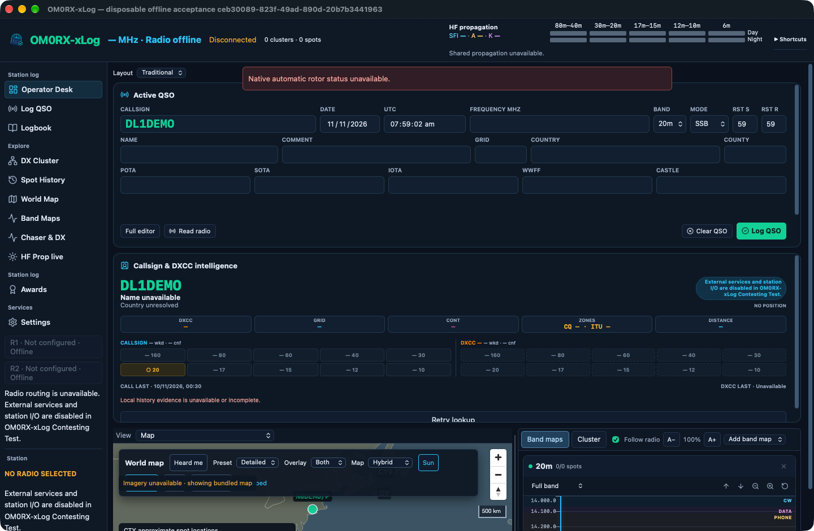
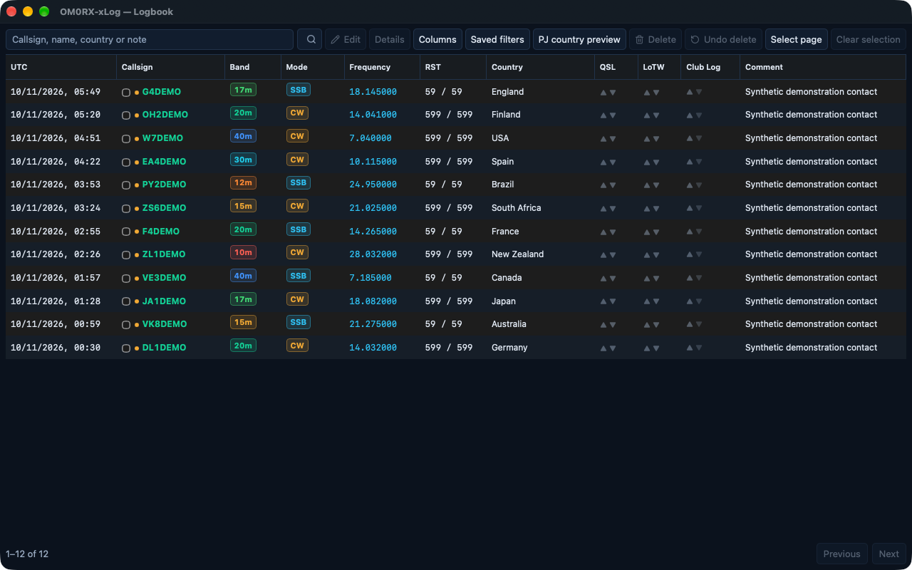
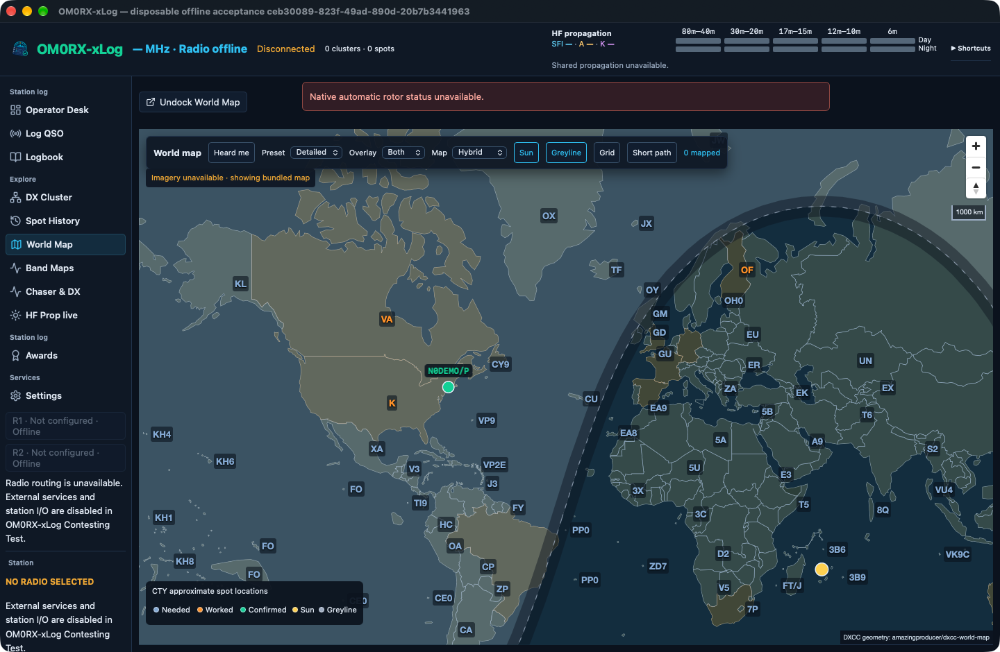
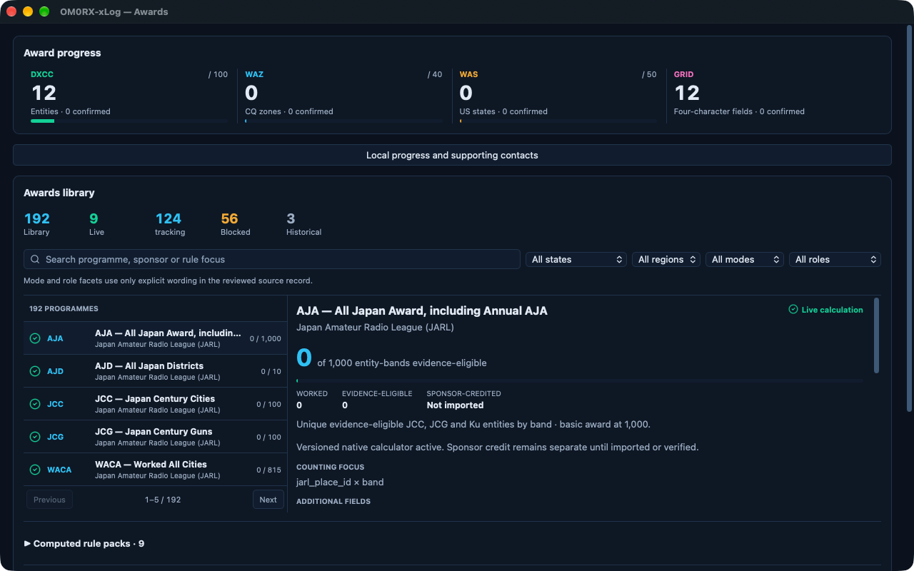

# OM0RX-xLog

OM0RX-xLog is a desktop logbook for amateur radio operators who want to keep their contacts on their own computer. Log a QSO at the Operator Desk, look up previous contacts, and use the same workspace for DX chasing and contests. The logbook works offline. Wavelog, online lookups and station control are optional.

**[Downloads and release notes](https://github.com/oliverbross/OM0RX-xLog-Releases/releases)** · [Report a problem](https://github.com/oliverbross/OM0RX-xLog-Releases/issues) · [Build from source](BUILD.md)

| Platform | Package to choose | Requirements |
| --- | --- | --- |
| macOS | [DMG](https://github.com/oliverbross/OM0RX-xLog-Releases/releases/download/v1.6.0/OM0RX-xLog-1.6.0-macOS-arm64.dmg) · [ZIP](https://github.com/oliverbross/OM0RX-xLog-Releases/releases/download/v1.6.0/OM0RX-xLog-1.6.0-macOS-arm64.zip) | Apple Silicon, deployment target macOS 14 or later. Use the release notes for the exact tested OS and Apple signing/notarization status. |
| Windows | [Current user](https://github.com/oliverbross/OM0RX-xLog-Releases/releases/download/v1.6.0/OM0RX-xLog-1.6.0-windows-x86_64-current-user-setup.exe) · [All users](https://github.com/oliverbross/OM0RX-xLog-Releases/releases/download/v1.6.0/OM0RX-xLog-1.6.0-windows-x86_64-all-users-setup.exe) · [Portable ZIP](https://github.com/oliverbross/OM0RX-xLog-Releases/releases/download/v1.6.0/OM0RX-xLog-1.6.0-windows-x86_64.zip) | Windows 11, x64 executable, Microsoft Evergreen WebView2 Runtime. The all-users installer requires elevation. The local qualification route uses x64 emulation on Windows 11 ARM64. |
| Linux | [DEB](https://github.com/oliverbross/OM0RX-xLog-Releases/releases/download/v1.6.0/OM0RX-xLog-1.6.0-Linux-x64.deb) · [Relocatable tar.gz](https://github.com/oliverbross/OM0RX-xLog-Releases/releases/download/v1.6.0/OM0RX-xLog-1.6.0-Linux-x64.tar.gz) | Ubuntu 24.04 amd64, GTK3/WebKitGTK 4.1, system Python 3.12 and the [listed runtime packages](prototype/scripts/linux-runtime-dependencies.txt). Online credentials require a desktop Secret Service provider. |

**Inside the app**

These screenshots show the released macOS app in a disposable workspace with synthetic contacts. Station output and external writes are disabled.

Operator Desk on macOS with the unsaved synthetic DL1DEMO contact and simulated station N0DEMO/P. Station output is disabled.

View the Logbook, World Map and Awards

Detached Logbook on macOS showing 12 synthetic contacts across bands and modes.

World Map on macOS with bundled country geometry, grayline, worked-country markers and the synthetic N0DEMO/P station.

Detached Awards on macOS with local progress from the 12 synthetic contacts and the programme library.

**What you can do**

- Log and edit contacts, search and page through the local SQLite logbook, save filters, review duplicates, and import or export ADIF. Back up the workspace and review a restore before applying it.
- Synchronize a configured station with Wavelog API v2, inspect pending operations and review conflicting edits. Keep one active writer for the same Wavelog station. Automatic synchronization needs a separate operator decision.
- Follow DX cluster and RBN spots, work a bandmap, explore the world map, and review award progress or portable activity. Local award calculations are not sponsor-issued credit.
- Switch between the normal Desk and contest operation. Contest definitions vary in their supported exchanges, scoring and exports; consult the definition's in-app readiness information and the sponsor's rules.
- Configure compatible radio and rotator providers. Hamlib helpers ship with the application. CW composition, keying, voice and PTT depend on the provider, operating system, permission and operator setup. CW decoding/skimming belongs to the separate OM0RX-Skimmer project; xLog can consume external cluster spots.

**Install and start**

On macOS, open the DMG and drag OM0RX-xLog into Applications, or extract the ZIP and move the app there. On Windows, pick one installer scope. The current-user default is under `%LOCALAPPDATA%\OM0RX-xLog`; the all-users default is under Program Files. Extract the whole portable ZIP before running `xlog-prototype.exe`; the adjacent DLLs, resources and helpers must stay together. The portable package needs WebView2 already installed; the installers can bootstrap it when online. Windows packages from the unsigned build route have no verified publisher signature. Match the download against the release's SHA256SUMS before running it.

On Ubuntu, install the downloaded DEB with `sudo apt install ./<downloaded-file>.deb` and start **OM0RX-xLog** from the application menu. For the archive, install the same system dependencies, extract the entire directory and run its `launch` script. Keep the program directory distinct from your logbook and backups.

On first run, choose or create your workspace and enter your station identity. Start with local logging. Connect a radio or rotor only after reviewing its settings. For Wavelog, enter the service URL, station ID and API token in Settings, check setup, then authorize the intended synchronization. Credentials belong in the application, never in an issue report.

**Upgrade and recover**

Back up the workspace and managed audio, keep the outgoing installer or app, and quit normally before replacing the program. Reopen the existing workspace and check a familiar contact, the draft and your saved settings. Do not use an app cleaner to remove profile data. To change Windows installer scope, uninstall the old scope with **Delete app data** unchecked before installing the new scope. A data rollback can discard contacts entered or synchronized since the backup: preserve the newer workspace before restoring anything.

**Platform differences and troubleshooting**

| Release platform | What was qualified | Limits |
| --- | --- | --- |
| macOS Apple Silicon | macOS 27.2; Developer ID signed, notarized and stapled app and DMG. Gatekeeper accepted the app from both packages. | Deployment target 14.0. The oldest supported macOS and Intel Macs were not tested; no Intel package is distributed. |
| Windows 11 x64 | Unsigned current-user and all-users installers; portable ZIP verified against its manifest. A nonadmin Standard user ran the app twice for each installed scope. Default paths, registration, Start menu entries, ordinary exits and uninstall preserving the profile marker passed. | Tested on Windows 11 ARM64 under x64 emulation. No physical native x64, Windows 10, or custom-path/interactive wizard qualification is claimed. |
| Ubuntu 24.04 amd64 | Ordinary user in an SDK-free environment under x86-64 emulation on Apple Silicon. Three X11 sessions and one nested Weston/Wayland session covered the DEB and relocated archive, including ordinary Quit and worker cleanup. | Requires the listed OS libraries and Python 3.12. Physical GPU, every compositor and other Linux distributions were not qualified. |

The release reuses Beta evidence for the unchanged large-log, backup/restore and inbound-only Wavelog paths. Simulated remote responses and disposable databases were used to test the new conflict and station-identity checks. The release did not repeat live synchronization or the long idle study.

One earlier Windows current-user test stopped during detached Logbook lifecycle verification with a WebView receive error. Its exact cause is unresolved. A single clean repeat on the same installer passed both full journeys, with independent native window and process observations. The failed run is excluded from the passing count.

### Station and digital integrations in 1.6.0

“Available” identifies an implemented connection path in the released application. The release used simulated devices, protocol fixtures and loopback services to check software behavior. It did not qualify a physical transmitter, keyer, rotator, microphone or audio wiring.

| Integration | macOS Apple Silicon | Windows x64 | Linux x64 | Operating scope |
|---|---|---|---|---|
| Hamlib radio and rotor | Available | Available | Available | Bundled Hamlib 4.7.2 rigctld and rotctld, or an existing local daemon. Frequency, mode, rotor positioning and other operations depend on the selected model and its reported capabilities. Dummy-device tests covered commands, observed motion and helper shutdown. |
| Independent serial WinKeyer | Available | Available | Available | Select a serial port and explicitly connect and arm. Supported legacy host revisions are WK2 23 and WK3 30/31. Software tests cover buffer handling, typed CW and Stop. Physical serial and keying behavior depends on the device and wiring. |
| Direct TCI | Available | Unavailable | Unavailable | Receive control over WebSocket. Transmit requires explicit permission, ExpertSDR3 advertising TCI 2.1, TX enable and fresh status. PTT addresses the selected TRX. CW accepts whole literal messages up to 128 characters and requires exactly one advertised TRX. TCI transmit-audio injection is unavailable. |
| Direct FLEX LAN and CWX | Available | Unavailable | Unavailable | Whole-message CW and, when the radio reports usable indexed CWX status, live literal-text append. Radio-reported progress depends on matching handle and character range. Buffered speed changes and typed prosigns are unavailable on this adapter. |
| Remote Station Agent client | Available | Unavailable | Unavailable | A Mac can connect to an existing Remote Station Agent. The Agent FLEX route sends whole CW messages. Index-based direct FLEX typing requires the direct LAN route. |
| Desk PTT and normal native voice memories | Available on eligible routes | Unavailable | Unavailable | Desk PTT requires a supported active Agent, direct FLEX or direct TCI route with the required ownership and station observations. Normal voice recording, monitor preview and transmitter audio use separately selected CoreAudio routes on macOS. Windows and Linux retain their separate contest WebView WAV playback path. |
| WSJT-X / JTDX UDP logging | Available | Unavailable | Unavailable | Receive and log supported external messages. Contest selection is non-transmitting. External Reply is unavailable. |
| fldigi integration | Available | Unavailable | Unavailable | The Mac bridge supports received text over XML-RPC and review of logged events for eligible contest destinations. Simulated external endpoints exercised these workflows. |

- WSJT-X/JTDX UDP logging and fldigi integration are macOS-only in this version. Direct FLEX, native voice and keyer capabilities also vary by platform. A visible setting or successful simulated command is not evidence of a connected hardware test.
- Windows qualification on an ARM64 machine under x64 emulation does not establish physical native x64 testing. Ubuntu X11 and nested Wayland checks do not cover every GPU, compositor or distribution. The macOS deployment target is distinct from a test on the oldest supported OS. See the release notes before relying on a particular device or workflow.
- For a blank Windows window, check WebView2 and confirm the entire package is present. For credentials that will not persist on Linux, check that the session's Secret Service is running and unlocked. If a synchronization was interrupted, inspect the recorded outcome before retrying a remote change.
- When [reporting an issue](https://github.com/oliverbross/OM0RX-xLog-Releases/issues), include your app version, OS/architecture, installer scope, and steps that reproduce the problem with demo data. Omit tokens, personal logbooks, recordings and private station addresses.

OM0RX-xLog uses React and Tauri for the desktop interface, a Swift worker for logbook and station services, and a bundled contest host. Source snapshots correspond to individual public releases. Contributions and reproducible reports are welcome through the public repository. Application code is distributed under [GPL v3](LICENSE); see [NOTICE](NOTICE) for third-party material and reference data.

Maintained by Oliver Bross, OM0RX.
